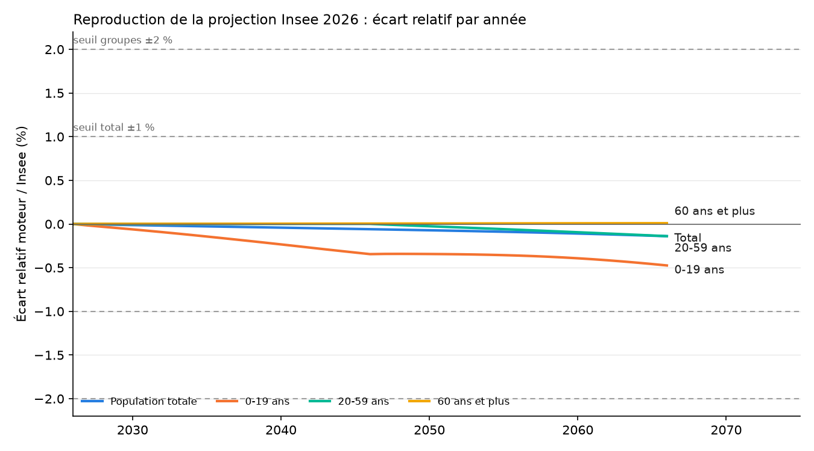

# Pension Sustainability Simulator

Simulateur Python de la soutenabilité financière d'un régime de retraite par répartition, sur 40 ans (2026-2065), avec incertitude Monte-Carlo.

**Statut : phases 1 (conception) et 2 (moteur démographique) terminées, phase 3 (moteur financier) à venir.** Aucun résultat actuariel n'est publié à ce stade.

## Problème

Dans un système par répartition, les cotisations des actifs financent les pensions des retraités. Son équilibre dépend du nombre de cotisants et de retraités, des salaires, du niveau des pensions et du taux de cotisation. Le vieillissement, la natalité, l'espérance de vie et le marché du travail peuvent le fragiliser, et les réformes imposent des arbitrages entre soutenabilité financière, niveau de vie des retraités et effort demandé aux actifs.

## Question de décision

> Dans quelles conditions un régime de retraite peut-il maintenir son équilibre financier sur les 40 prochaines années, et quelles combinaisons de réformes permettent d'assurer sa soutenabilité sans faire peser une charge excessive sur une génération particulière ?

## Ce que fait le modèle (v0.1)

- Un **régime consolidé fictif** à prestations définies, avec **une seule réserve** $R_t$ (solde signé) et des montants en **euros constants 2026**.
- Une population par **catégorie d'affiliation** (privé, public, indépendants), **sexe** et **âge**, projetée chaque année : mortalité, vieillissement, migrations, naissances.
- Un départ à la retraite déterministe à l'âge légal de la génération plus un écart observé.
- Deux critères de soutenabilité :
  - **A, déterministe** : $R_t \geq 0$ sur tout l'horizon pour un scénario donné ;
  - **B, probabiliste (critère principal)** : $\mathbb{P}(\min_t R_t \geq 0) \geq \alpha$ avec $\alpha \in \{80\,\%, 90\,\%, 95\,\%\}$, estimé par Monte-Carlo ($N = 10\,000$) et décidé avec la **borne basse de Wilson à 95 %**. Les résultats donnent toujours $\hat p$, la borne $L_N$ et $\alpha$.
- Un taux de cotisation d'équilibre $\tau^*$ pour chaque critère.

La spécification complète est dans [`docs/cahier-des-charges.md`](docs/cahier-des-charges.md).

## Ce que le modèle n'est pas

Il ne reproduit pas le système de retraite français et n'est pas un outil de recommandation politique. Ses résultats sont **conditionnels aux hypothèses** : une probabilité de soutenabilité n'est pas une probabilité réelle, et la précision Monte-Carlo mesure le bruit des simulations, pas la justesse du modèle.

## Limites assumées (v0.1)

- La carrière individuelle n'est pas modélisée : la pension d'un nouveau retraité vaut $\theta_c \times$ salaire à l'âge de départ, un salaire représentatif agrégé et non une liquidation individuelle.
- Le taux de cotisation initial $\tau_0 = B_{2026}/A_{2026}$ est un **taux de calibration du modèle**, pas un taux légal. L'équilibre de 2026 est une condition de calibration, pas un résultat.
- Affiliations fixes, taux de cotisation unique, retraites anticipées, réversion, minima de pension, décote et surcote exclus.
- Les parts de chaque catégorie et d'autres paramètres sont des **hypothèses documentées** quand les données manquent.
- Les valeurs sont **provisoires** tant qu'elles ne sont pas sourcées ; aucune n'est présentée comme officielle.

## Données

Les fichiers bruts (Insee, Drees, COR, DGAFP, MSA) ne sont **pas versionnés** : ils sont placés dans `data/raw/`, ignoré par Git, et jamais modifiés. Chaque jeu de données a une fiche de provenance (organisme, URL, dates, millésime, champ, licence, transformations) dans [`docs/donnees.md`](docs/donnees.md). Les hypothèses et leurs statuts sont dans [`docs/hypotheses.md`](docs/hypotheses.md).

## Organisation du dépôt

| Dossier ou fichier | Rôle |
|---|---|
| `docs/` | Cahier des charges, fiches de provenance, hypothèses, plan de validation, architecture |
| `config/assumptions.yaml` | Tous les paramètres, avec statut et source ; aucune valeur codée en dur dans le code |
| `src/` | Code du simulateur (voir [`docs/architecture.md`](docs/architecture.md)) |
| `tests/` | Tests Pytest |
| `scripts/` | Vérification des fichiers bruts, comparabilité avec l'Insee, reproduction de la projection, graphiques |
| `notebooks/` | Exploration ; le code utile est déplacé vers `src/` |
| `data/raw/`, `data/processed/` | Données (ignorées par Git) |
| `LEARNING.md` | Journal d'apprentissage du projet |

## Installation et tests

```powershell
python -m venv .venv
.\.venv\Scripts\Activate.ps1
pip install -r requirements.txt
pytest
```

Les fichiers Insee sont à placer à la main dans `data/raw/` (`python scripts/check_raw_data.py` les vérifie). Sans eux, les tests qui les lisent sont ignorés.

## Phase 2 : moteur démographique

Le moteur projette la population par catégorie, sexe et âge de 2026 à 2066 (calendrier : mortalité, vieillissement, migrations, naissances ; classe ouverte à 100 ans et plus). Alimenté avec les mêmes hypothèses de mortalité, de fécondité et de migration que la projection Insee 2026 (scénario central), il retrouve ses populations à moins de 0,15 % près pour la population totale et 0,5 % pour les groupes d'âge, chaque année, contre des seuils fixés à 1 % et 2 % avant les tests.



Cette comparaison contrôle l'**implémentation** : se rapprocher d'une projection construite avec les mêmes hypothèses ne valide pas la capacité à prévoir la démographie. Les conventions de calcul et les écarts connus sont dans [`docs/conventions-moteur.md`](docs/conventions-moteur.md) et [`docs/comparabilite-insee.md`](docs/comparabilite-insee.md).

## Feuille de route

| Phase | Contenu | État |
|---|---|---|
| 1 | Conception : cahier des charges, données, hypothèses, validation | Terminée |
| 2 | Moteur démographique et tests | Terminée |
| 3 | Moteur financier et calibration de 2026 | À venir |
| 4 | Indicateurs actuariels ; première version publiable | À venir |
| 5 | Incertitude : Monte-Carlo, critères A et B | À venir |
| 6 à 8 | Réformes et équité, agent IA, application finale (optionnelles) | À venir |

## Licence

MIT. Les données d'origine restent soumises aux licences de leurs producteurs (voir `docs/donnees.md`).
