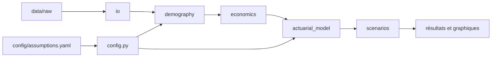

# Architecture logicielle préliminaire

Version préliminaire (fin de phase 1). Elle sert de guide pour les phases 2 à 5 et sera ajustée au fil du code ; toute modification importante est notée en fin de document.

## 1. Principes

1. **Aucun paramètre numérique dans le code** : tout est lu dans `config/assumptions.yaml`. Un paramètre `null` nécessaire à un calcul fait échouer l'exécution avec un message clair, jamais une valeur par défaut silencieuse.
2. **Fonctions pures**, sans état global : une fonction reçoit ses entrées et renvoie ses sorties.
3. **Aléa explicite** : le générateur `np.random.default_rng(seed)` est passé en argument, jamais créé au milieu d'une fonction.
4. **Pas de correction silencieuse** : une incohérence (taux d'emploi supérieur à 1, départs migratoires supérieurs à l'effectif présent) est détectée, journalisée et signalée ; elle n'est jamais plafonnée ou tronquée en silence.
5. **Vectorisation NumPy** sur l'axe des simulations dès la phase 3, sans boucle Python sur les simulations.
6. **Conventions uniques** : populations au 1er janvier de l'année $t$, calendrier annuel mortalité → vieillissement → migrations → naissances, euros constants 2026.

## 2. Arborescence cible

```
src/
  config.py              # lecture et validation de assumptions.yaml
  conventions.py         # indices des sexes, unités des fichiers Insee
  data_io/               # chargement des fichiers de data/raw/ (Insee, Drees, COR)
  demography/            # phase 2
    population.py        # structures de données, population initiale
    categories.py        # attribution des catégories (parts pi_c)
    migration.py         # flux bruts, règle de dépassement
    engine.py            # transition annuelle t -> t+1
    comparison.py        # projection sur plusieurs années, écarts avec une référence
  economics/             # phase 3
    employment.py        # taux d'emploi conditionnel e
    wages.py             # profils salariaux, assiette A_t
    macro.py             # productivité, chômage, indexation
  actuarial_model/       # phases 3 et 4
    retirement.py        # âge de départ, part de retraités rho (T8 dès la phase 2)
    pensions.py          # stock observé, liquidations theta_c x salaire
    finance.py           # cotisations, déficit, réserves
    calibration.py       # tau_0, k
    indicators.py        # ratio, tau*, âge d'équilibre, engagements
  scenarios/             # phases 5 et 6
    stochastic.py        # chocs aléatoires
    montecarlo.py        # simulations, critères A et B, Wilson
    reforms.py           # leviers de réforme
tests/
  test_demography.py
  test_toy_example.py
  test_insee_reproduction.py
  ...
scripts/                 # téléchargement et préparation des données
notebooks/               # exploration
```

## 3. Flux de données



La démographie ne dépend pas de la finance : on peut donc la valider seule (phase 2) avant de brancher le reste.

## 4. Structures de données (conventions)

| Objet | Forme | Remarque |
|---|---|---|
| Population segmentée $N$ | `N[c, s, a]` avec $c \in \{0,1,2\}$ (privé, public, indépendants), $s \in \{0,1\}$ (femmes, hommes), $a \in [a_0, 100]$ | Pour $a \geq a_0$ |
| Population non segmentée | `N_pre[s, a]` pour $a < a_0$ | Répartie entre catégories à l'âge $a_0$ |
| Classe ouverte | Dernier indice `a = 100` | Regroupe les âges de 100 ans et plus |
| Plusieurs simulations (phase 3) | Axe supplémentaire en tête : `[sim, ...]` | Pas de boucle Python sur cet axe |
| Calendrier | Années entières `t = 2026, ...` | Index = `t - 2026` |

Type : `float64` (les effectifs projetés ne sont pas entiers).

## 5. Interfaces principales

| Fonction | Entrées | Sorties |
|---|---|---|
| `load_config(path)` | Chemin du YAML | Dictionnaire validé |
| `initial_population(raw, config)` | Fichiers bruts, parts $\pi_c$ | `N_pre`, `N` à 2026 |
| `step_year(N_pre, N, params_t)` | Population au 1er janvier $t$, paramètres de l'année | Population au 1er janvier $t+1$ et journal des alertes |
| `retired_share(a, g, config)` | Âge, génération | $\rho \in \{0, 1\}$ |
| `conditional_employment(e_obs, rho)` | Taux observé, part de retraités | $e$ (erreur si $e > 1$) |
| `reserves(R0, D, r)` | Réserve initiale, déficits, rendements | Trajectoire $R_t$ |
| `wilson_lower_bound(successes, n, conf)` | Nombre de succès, $N$, niveau | Borne basse $L_N$ |

## 6. Correspondance avec les phases et les tests

| Phase | Modules | Tests (docs/plan-de-validation.md) |
|---|---|---|
| 2 | `data_io`, `config`, `demography` | T1 à T10, T12 ; cas jouet ; reproduction Insee |
| 3 | `economics`, `actuarial_model` | T11 ; cas jouet étendu aux flux financiers ; $D_{2026} = 0$ |
| 4 | `actuarial_model.indicators` | Cohérence des indicateurs |
| 5 | `scenarios` | Monotonie en $\tau$ ; tirages communs ; précision Monte-Carlo |

## 7. Outils

- Python avec environnement virtuel ; dépendances dans `requirements.txt`.
- Tests : `pytest` avec `pythonpath = src` dans `pytest.ini` (en place depuis la phase 2).
- Intégration continue : GitHub Actions (`.github/workflows/tests.yml`) installe les dépendances et lance `pytest` à chaque push. Les tests qui lisent `data/raw/` sont ignorés (« skipped ») hors de la machine locale.

## 8. Journal des modifications

| Date | Modification | Raison |
|---|---|---|
| 25/11/2026 | Version préliminaire | Fin de la phase 1 |
| 25/11/2026 | `io/` devient `data_io/` ; ajout de `conventions.py` et `demography/comparison.py` | Un paquet `io` masque le module standard `io` de Python ; besoin de conventions d'indexation partagées et d'une projection multi-années réutilisable |
| 25/11/2026 | Conventions du moteur (migration de l'âge 0, naissances, classe ouverte) | Voir `docs/conventions-moteur.md` |
